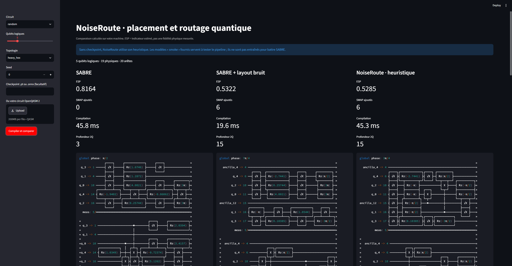

# NoiseRoute

**Placement et routage de qubits sensibles au bruit, appris par IA (GNN + Transformer).**

    

[](assets/demo.png)

## (English)

NoiseRoute is a research platform for **noise-aware qubit placement and routing**. A single learned policy (GATv2 over the device graph + a Transformer over the circuit DAG window) decides the initial layout and the SWAP insertions to maximize the estimated success probability (ESP) of a compiled circuit. It ships with a Rust/PyO3 environment, SABRE baselines, a Qiskit transpiler plugin, and ONNX/OpenVINO export. Status: **experimental v0.1.0**. The pipeline runs and is tested; no superiority over SABRE is claimed yet, and losing cases are kept in the result CSVs.

---

## En bref

| | |
|---|---|
| **Problème** | Sur un vrai processeur quantique, chaque porte et chaque qubit a son propre taux d'erreur. Placer et router un circuit en ignorant ce bruit dégrade la fidélité du résultat. |
| **Approche** | Une politique unique apprise (GATv2 sur le graphe du device + Transformer sur la fenêtre DAG du circuit) choisit le placement initial puis les SWAP, avec pour objectif d'améliorer l'ESP. |
| **Entraînement** | Imitation de traces SABRE, puis PPO masqué avec pénalité KL et récompense `Δ log(ESP)` face à SABRE. |
| **Intégration** | Plugin Qiskit (`layout_method="noiseroute"`, `routing_method="noiseroute"`), export ONNX et OpenVINO (CPU/NPU). |
| **État** | v0.1.0 expérimentale. Pipeline exécutable et testé, campagne scientifique à réaliser. |

## Résultats actuels

> Benchmark reproductible : 5 circuits × 2 devices × 3 algorithmes × 20 seeds (`results/small20`, 600 compilations) et corpus externe de 10 circuits figés (1 800 compilations).

| Circuit | Device | Métrique | SABRE niv. 3 | SABRE + placement bruit | NoiseRoute | Verdict |
Circuit	Device	Algo	ESP	SWAP	Profondeur 2Q
random (5q, seed 0)	heavy-hex	SABRE	0.8164	0	3
random (5q, seed 0)	heavy-hex	SABRE + placement bruit	0.5322	6	15
random (5q, seed 0)	heavy-hex	NoiseRoute (heuristique)	0.5285	6	15
**Ce que montrent les résultats** (À REMPLIR : 2 à 3 phrases, par exemple dans quels cas NoiseRoute fait mieux, dans quels cas il perd, et l'hypothèse expliquant pourquoi).

### Ce que ce projet ne prétend pas

- Aucune supériorité démontrée sur SABRE ni sur AIRouting.
- Aucune généralisation zéro-shot revendiquée.
- Aucune latence NPU mesurée sur du matériel non vérifié (pas de basculement CPU silencieux).
- Les poids fournis viennent d'un entraînement très court de validation.
- 20 répétitions d'un algorithme déterministe ne sont pas 20 observations indépendantes : le petit benchmark valide le pipeline, il ne prouve pas la généralisation.

Les cas perdants sont conservés dans les CSV. Détails : [docs/VALIDATION.md](docs/VALIDATION.md) et [docs/PROTOCOL.md](docs/PROTOCOL.md).

## Démarrage rapide

**Linux / WSL**

```bash
bash scripts/setup_linux.sh cuda
source .venv/bin/activate
python -m pytest -q
python -m streamlit run examples/demo.py
```

**Windows (PowerShell)**

```powershell
./scripts/setup_windows.ps1 -Cuda
./scripts/run_menu.ps1
```

Si PowerShell bloque les scripts, utilise `./scripts/setup_windows.cmd -Cuda` puis `./scripts/run_menu.cmd`. Plus de détails dans [docs/INSTALL.md](docs/INSTALL.md).

### Exemple Qiskit

```python
from qiskit import QuantumCircuit, transpile
from noiseroute.device import synthetic

qc = QuantumCircuit(5)
qc.h(0)
qc.cx(0, 4)
qc.cx(0, 2)
qc.measure_all()

device = synthetic("ring", 5, seed=7)
result = transpile(
    qc, target=device.target(), optimization_level=3,
    layout_method="noiseroute", routing_method="noiseroute",
)
print(result)
```

Sans checkpoint, le plugin utilise une heuristique. Pour la politique apprise, définis `NOISEROUTE_MODEL`, `NOISEROUTE_ENGINE=onnx` et `NOISEROUTE_BEAM`.

## Reproduire les résultats

```bash
make bench OUT=runs/bench-001                                        # 600 compilations
python -m noiseroute bench --config configs/bench-corpus.yaml --out runs/corpus-001   # 1 800 compilations
make reproduce OUT=runs/reproduction-001                             # imitation, PPO court, export, latences, bruit
```

## Entraîner et exporter

```bash
python scripts/train_competitive.py          # parcours comparatif avec validation à 20 seeds
python -m noiseroute imitate --config configs/train-laptop.yaml --out runs/laptop-bc
python -m noiseroute train --config configs/train-laptop.yaml --checkpoint runs/laptop-bc/imitation.pt --out runs/laptop-ppo
python -m noiseroute export --checkpoint runs/student.pt --out runs/student.onnx
```

Le parcours comparatif n'écrit `accepted.pt` qu'après validation obligatoire à 20 seeds. Reprise d'un entraînement interrompu : [docs/TRAINING_RECOVERY.md](docs/TRAINING_RECOVERY.md).

## Ce qui est livré

| Brique | Contenu |
|---|---|
| Circuits | QFT, Grover, ansatz, random, arithmétique ; imports MQT Bench / QASMBench ; 10 circuits externes figés |
| Devices | Ligne, anneau, grille, heavy-hex, graphe géométrique ; snapshot calibré FakeBrisbane 127 qubits |
| Baselines | SABRE niveau 3, SABRE avec placement sensible au bruit, adaptateur AIRouting isolé |
| Environnement | Placement injectif puis SWAP masqués ; DAG, permutations et transitions en Rust, oracle Python |
| Politique | GATv2 (device) + Transformer (fenêtre DAG), têtes placement / SWAP / critique partagées |
| Apprentissage | Imitation SABRE, PPO masqué, curriculum 5 → 20 → 50 qubits, baseline SB3 MaskablePPO |
| Recherche | Beam search configurable, secours par plus court chemin avec comptage des recours |
| Bruit | ESP native (erreurs de portes, lecture, idles ASAP), simulation Aer, distance de Hellinger |
| Échelle | Encodeur hiérarchique, vérification structurelle d'un routage 100 → 127 qubits |
| Déploiement | Distillation, ONNX statique, OpenVINO CPU/NPU, plugins Qiskit layout et routing |
| Reproductibilité | CSV, QPY, snapshots, hashes, tests, CI, Docker, scripts Windows/Linux, démo locale |

## Feuille de route

Prochaines étapes:

- [ ] Benchmark sur le corpus externe avec analyse statistique par circuit
- [ ] Validation sur du matériel réel ou un simulateur bruité calibré
- [ ] Mesures de latence NPU vérifiées
- [ ] Rédaction et publication des résultats

Plan complet : [docs/ROADMAP.md](docs/ROADMAP.md).

## Documentation

[Installation](docs/INSTALL.md) · [Architecture et limites](docs/ARCHITECTURE.md) · [Protocole et métriques](docs/PROTOCOL.md) · [Validations](docs/VALIDATION.md) · [Sources](docs/SOURCES.md) · [Fiche des modèles](models/README.md)

## Contact

**Kévin Landbeck** : [LinkedIn](https://www.linkedin.com/in/kevin-landbeck-b94884242) · [GitHub](https://github.com/lankev)

Retours, critiques sur le protocole de benchmark et idées sont les bienvenus (issues ou message direct).

## Licence

Code sous licence MIT. Les fichiers QASMBench conservent leur licence et leur NOTICE.
